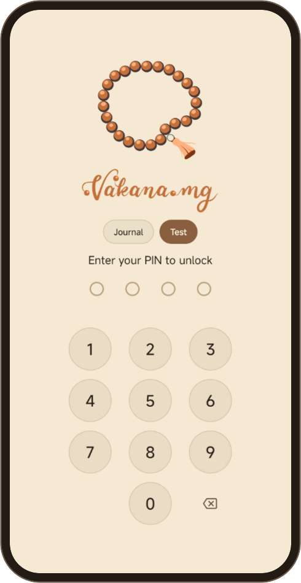
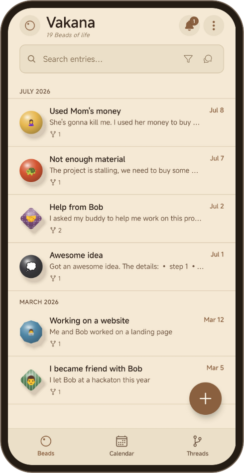
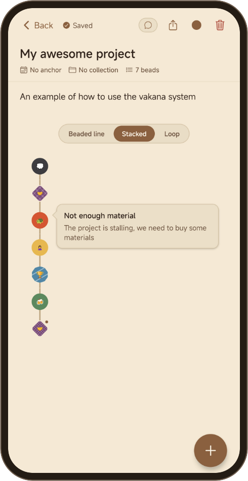

<p align="center">
  
</p>

<p align="center"><b>A Malagasy knowledge management system, on your phone.</b></p>

*Vakana* is the Malagasy word for bead. This app is a small fragment of what the physical **Vakana System**, the Malagasy ancestral practice of beads, is capable of. You write a note, give it a bead, and string the beads into threads. The background is in the essay [*My Ancestors Were Writing Lisp*](https://donovan-ratefison.mg/2026/05/31/My-Ancestors-Were-Writing-Lisp/).

**Android only**. The APK is on the [releases page](https://github.com/donovan-ratefison/vakana.mg/releases) and at [vakana.mg](https://vakana.mg/#get).

<p align="center">
  
  &nbsp;
  
  &nbsp;
  
</p>

## How it works


https://github.com/user-attachments/assets/b6d82fcf-026f-4adf-99c7-72fe43b7e5c0


- An **entry** is text with markdown, photos and voice notes. It saves as you type; there is *no save button*.
- Each entry can carry one **bead**, composed from eight shapes, eight patterns, a mood that sets its color, and a glyph you type. *You decide what a bead means.* You can save a bead under a name and use it again with one tap.
- A **thread** is a chain of beads: a story, a project, a habit. Days thread themselves, and you can string your own. When a cycle ends, you close the thread, and the chain clasps into a ring.
- There are three views:
  - ***Vakana***: entries, grouped by day.
  - ***Tetiandro***: one month at a time, with the bead and the reminders of each day.
  - ***Tohivakana***: threads.
- You can filter entries by shape, mood, pattern and glyph.
- Entries and threads take comments, and a comment can carry a reminder.
- A thread exports to **Org**, **Markdown**, **HTML**, **PDF** or a **slide deck**. Exports go *one way*; nothing syncs back.

## Privacy

There are **no accounts, no sync and no telemetry**. Everything stays on the device until you export it.

The PIN gates the app's screens and nothing else. The database, photos and voice notes stay **unencrypted** in the app's private storage. **Warning: if you uninstall the app, you delete the journal**, unless you exported a backup from Settings → Vault → Backup & Restore.

## Build from source

```
npm install
npm start          # Expo dev server
npm run android    # run on a connected device or emulator
npm test           # unit tests
```

Expo SDK 54, React Native 0.81, plain JavaScript. Scheduled notifications need a development build (`npx expo run:android`); Expo Go on Android does not deliver them. The iOS and web targets were never built or tested.

## Documentation

- [User guide](docs/user-guide.md)
- [Use cases](docs/use-cases.md)
- [Possibilities](docs/possibilities.md)
- [Workflows](docs/workflows.md)
- [Architecture](docs/architecture/README.md)
- [Changelog](CHANGELOG.md)

## License

The source code is licensed under the [Apache License 2.0](LICENSE). Bundled third-party assets are listed in [NOTICE.md](NOTICE.md).

The licence covers **the code only**. The Vakana.mg name, the logo and the brand artwork are not licensed for reuse. The brand artwork files are `assets/icon.png`, `assets/adaptive-icon.png`, `assets/splash-icon.png`, `assets/logo-mark.png`, `assets/favicon.png` and `assets/notification-icon.png`. A fork that is distributed needs its own name, icon and package id.
